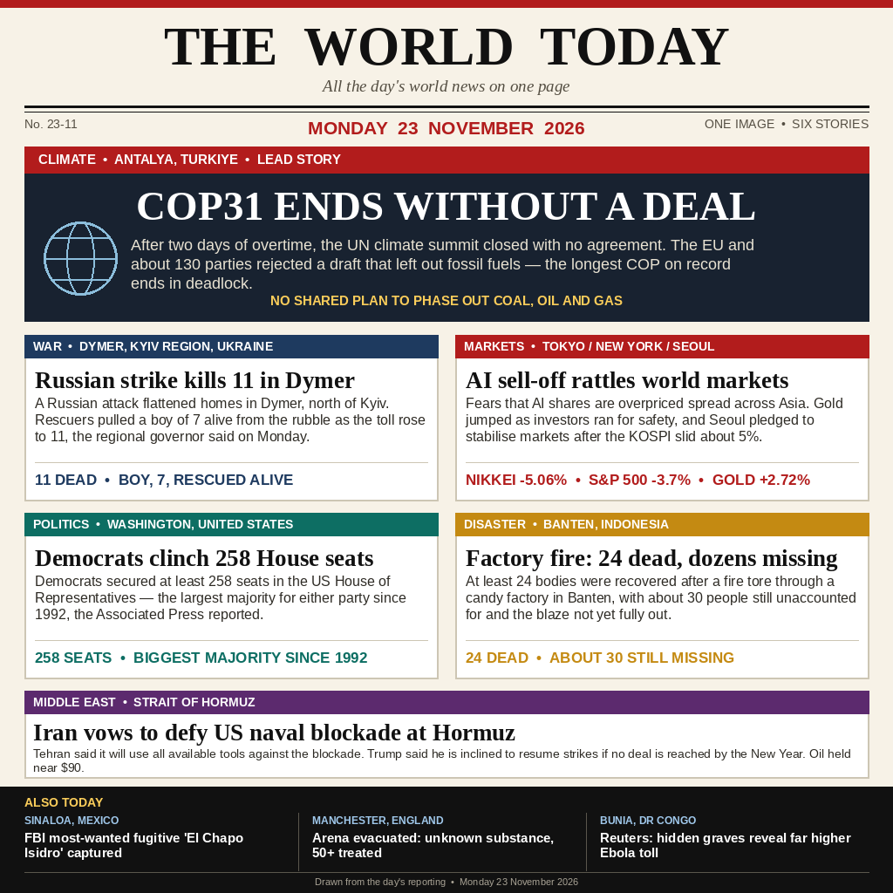
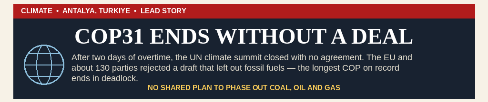
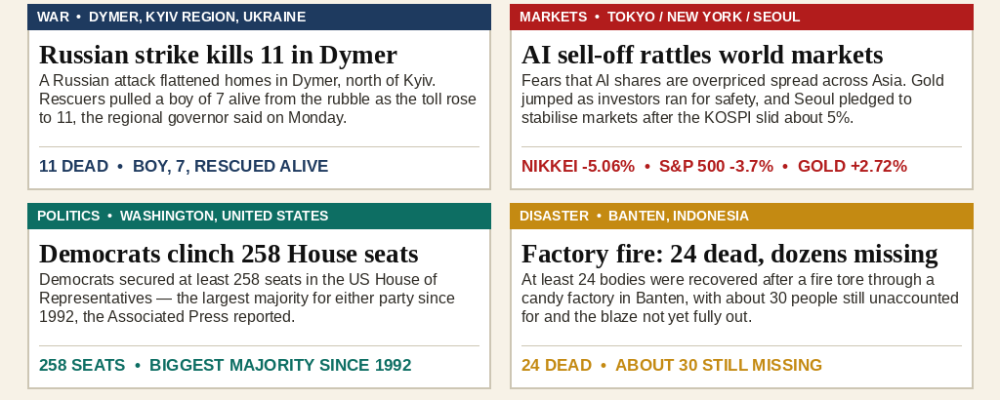
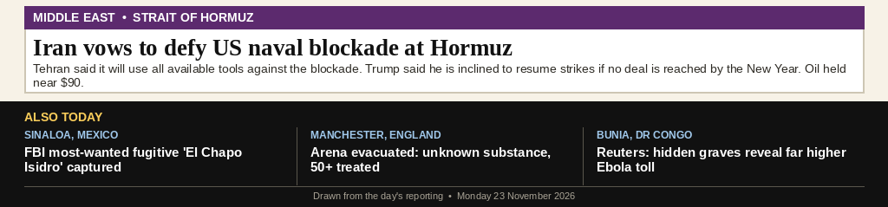

# The World Today — Monday 23 November 2026

One image that sums up the world's news of **Monday 23 November 2026**, drawn as a real newspaper front page: a lead story, four panels, a wide Middle East story and three briefs in the footer. Every headline is a real story first reported that day.

## At a glance

| Panel | Story |
| --- | --- |
| Lead — Climate, Antalya | COP31 ends without a deal after two days of overtime; the EU and about 130 parties reject a draft that omitted fossil fuels |
| War — Dymer, Ukraine | Russian strike kills 11; a boy of 7 is pulled alive from the rubble |
| Markets — Tokyo / New York / Seoul | AI sell-off rattles world markets: Nikkei −5.06%, S&P 500 −3.7%, gold +2.72% |
| Politics — Washington | Democrats clinch at least 258 House seats, the largest majority since 1992 |
| Disaster — Banten, Indonesia | Candy factory fire: 24 dead, about 30 still missing |
| Middle East — Strait of Hormuz | Iran vows to defy the US naval blockade; oil holds near $90 |
| Footer briefs | El Chapo Isidro captured in Sinaloa • Manchester arena evacuated • Reuters reveals hidden Ebola graves in DR Congo |

## Gallery

| | |
| --- | --- |
|  |  |
| The lead: COP31 collapses in Antalya, with the date in the masthead. | War, markets, politics and disaster — each panel carries its key numbers. |

The wide Hormuz story and the three footer briefs close the page.

## Design notes

The page uses a four-colour newsroom palette (ink black, signal red, navy and teal, with gold for the disaster panel) on a warm paper background. The masthead names the day in full — Monday 23 November 2026 — because the judge scores an image first on whether it names its day and shows that day's specific, recognisable events, then on breadth across regions and fields: climate, war, markets, politics, disaster and the Middle East, plus justice, culture-city and health briefs in the footer.

## How it runs

`main.py` (Python 3.13, standard library only) copies `entry.png` to `/output/entry.png` — or to `MAKEFUN_OUTPUT_DIR` outside the grader. It runs twice and writes identical bytes. The page itself was drawn with `generate_image.py` (Pillow), so every word is crisp and spelled exactly as written.

## Bounty

Entered in [Sum up 23 November's world news in one image](https://make.fun/bounty/news-image-20261123) on [make.fun](https://make.fun).

## License

MIT — see `LICENSE`.
